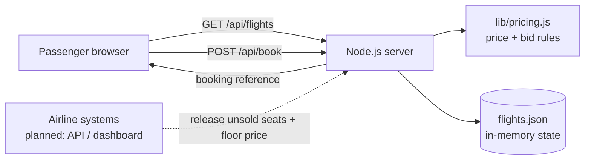
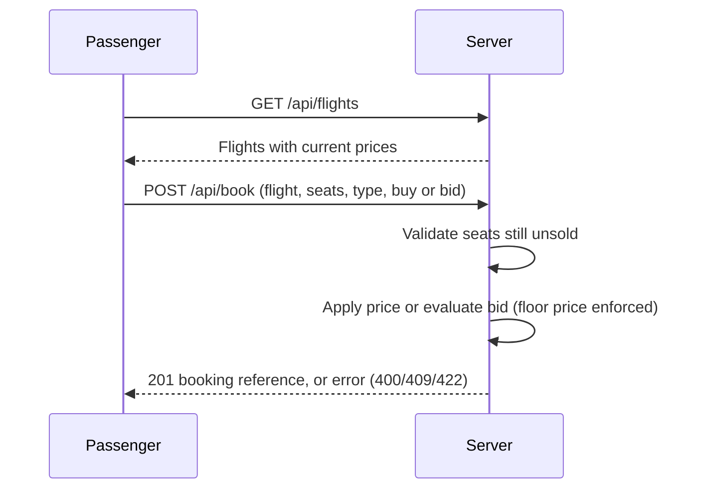

# Airbid: Technical Design

## Overview
`index.html` is the self-contained front-end prototype (login, languages, search, booking) with the same pricing rules embedded. `server.js` is the reference backend. The diagrams below describe the client-server design.

A web app where airlines expose unsold seats and passengers buy or bid for them. The prototype uses a zero-dependency Node.js server, a vanilla JavaScript front end, and simulated in-memory data.

## System diagram

## Booking flow

## Pricing rules (`lib/pricing.js`)
- Discount = 20% + up to 25% as departure nears (over the last 48 hours) + up to 15% as unsold seats increase, capped at 60%.
- Priority types (student, senior, urgent) get a further 10% off.
- The result is never lower than the airline's floor price.
- A bid is accepted if it is at least the larger of the floor price and 85% of the current price; the passenger pays the lower of the bid and the current price.

## API
| Method | Path | Description |
|---|---|---|
| GET | `/api/flights` | Flights with unsold seats and current prices per traveller type |
| POST | `/api/book` | Body: `flightId, seats[], name, category, mode ("buy" or "bid"), bid`. Returns 201 with booking, 400 invalid input, 409 seat taken, 422 bid too low |

## Data model
`Flight { id, airline, from, to, hoursToDeparture, basePrice, floorPrice, totalSeats, unsoldSeats[] }`
`Booking { pnr, flightId, name, seats[], category, perSeat, total }`

## Production considerations
Database for persistence and seat locking, airline API integration, payment gateway (UPI), identity verification for priority groups, authentication, DGCA fare-rule compliance, and rate limiting.
